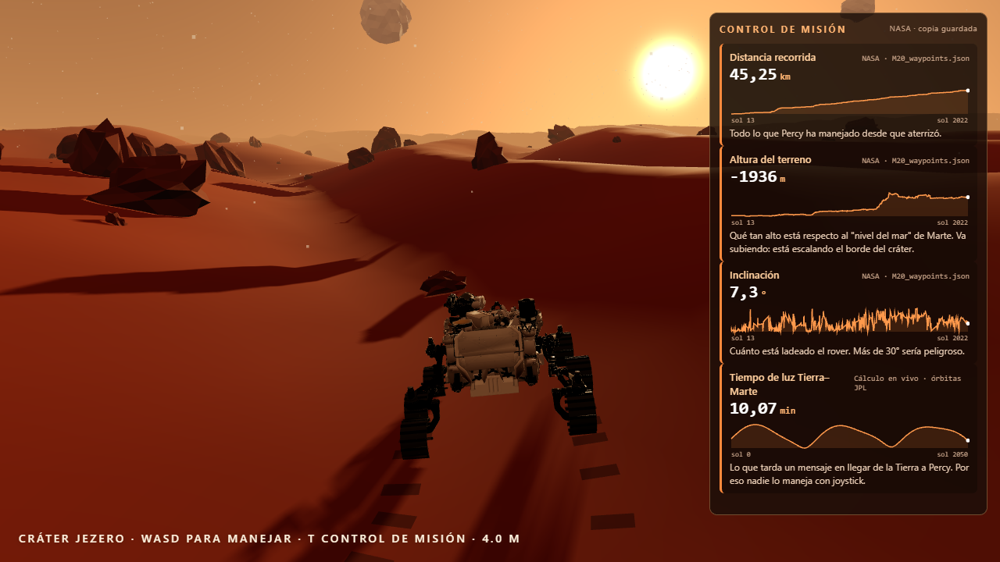

<div align="center">

# 🔴 Mars Perseverance 3D

**Simulación 3D interactiva del rover Perseverance de la NASA en el cráter Jezero, con telemetría real de la misión.**
*Interactive 3D simulation of NASA's Perseverance rover in Jezero Crater, powered by real mission telemetry.*




[Español](#-español) · [English](#-english)

</div>

---

## 🇪🇸 Español

### ✨ Qué hace
- 🏜️ **Marte cinematográfico:** dunas generadas por ruido, pared del cráter, cielo caramelo con shader, niebla de polvo, ~3000 partículas movidas por el viento, ~180 rocas con sombras suaves y las lunas **Fobos** y **Deimos**.
- 🚙 **Rover manejable:** modelo 3D oficial de la NASA, control con `W` `A` `S` `D`, ruedas con giro, dirección y suspensión, huellas en la arena y cámara que sigue al rover.
- 📡 **Panel "Control de misión"** (tecla `T`), inspirado en [NASA Open MCT](https://github.com/nasa/openmct):
  - **Distancia recorrida real** (~45 km), **altura del terreno** e **inclinación**, calculadas desde los *waypoints* oficiales de la misión (sol 13 → sol 2022).
  - **Tiempo de luz Tierra–Marte**, calculado en vivo con los elementos orbitales de NASA/JPL.
- 🔌 **Datos en vivo con respaldo:** `server.js` pide los datos a la NASA (evitando CORS) y, si no hay conexión, usa una copia local.

### 🤖 Desarrollo con agentes de Claude
Este proyecto se construyó con **agentes de Claude Code**, siguiendo un flujo iterativo:
1. **Plan** aprobado antes de escribir código.
2. **Iteraciones cortas**: paisaje → rover → movimiento → cámara → telemetría.
3. **QA automático:** después de cada cambio, `npm run check` abre la página en Chrome *headless* (WebGL con SwiftShader), guarda una captura y falla si hay errores de consola, de la página o de red. El agente revisa la captura y corrige, hasta llegar a 0 errores.

Mi rol: definir la visión y los requisitos, tomar las decisiones técnicas, revisar cada iteración e integrar los datos reales de la NASA.

### ▶️ Cómo ejecutarlo
```bash
npm install      # solo instala playwright-core (para el QA)
npm start        # http://localhost:5173
npm run check    # QA automático: captura + reporte de errores
```
**Controles:** `W` `A` `S` `D` para manejar · `T` muestra u oculta el panel "Control de misión".

---

## 🇬🇧 English

### ✨ Features
- 🏜️ **Cinematic Mars:** noise-generated dunes, crater rim, shader-based butterscotch sky, dust fog, ~3,000 wind-driven particles, ~180 rocks with soft shadows, and the moons **Phobos** and **Deimos**.
- 🚙 **Drivable rover:** official NASA 3D model, `WASD` controls, wheel spin, steering and suspension, tire tracks, and a follow camera.
- 📡 **Mission Control panel** (`T` key), inspired by [NASA Open MCT](https://github.com/nasa/openmct): real distance driven, elevation and tilt from official mission waypoints, plus a live Earth–Mars light-time calculation based on JPL orbital elements.
- 🔌 **Live data with fallback:** a zero-dependency Node server proxies NASA data (avoiding CORS) and falls back to a cached copy when offline.

### 🤖 Built with Claude Code agents
Developed with **Claude Code agents** in a plan → iterate → verify loop. Each iteration ended with an automated Playwright check (headless Chrome + SwiftShader WebGL) that captures a screenshot and fails on any console, page or network error. I defined the vision and requirements, made the technical decisions, reviewed every iteration, and integrated the real NASA data.

### ▶️ Run it
```bash
npm install && npm start   # http://localhost:5173
npm run check              # automated QA
```

---

## 🛰️ Créditos y datos / Credits & data

| Recurso / Resource | Archivo / File | Fuente / Source |
|---|---|---|
| Modelo 3D del rover | `public/models/perseverance.glb` | [NASA 3D Resources](https://science.nasa.gov/3d-resources/) |
| Recorrido real (hasta el sol 2022) | `public/data/M20_waypoints.json` | NASA/JPL, Mars 2020 MMGIS maps |
| Órbitas de la Tierra y Marte | `perseverance.html` | Elementos orbitales NASA/JPL (J2000) |
| Fotos reales de las cámaras de Percy (soles 2018–2024) | `public/fotos/` | [NASA Mars 2020 Raw Images](https://mars.nasa.gov/mars2020/multimedia/raw-images/) (API `mars.nasa.gov/rss/api/?feed=raw_images`) |

Imágenes y modelos de la NASA: cortesía de NASA/JPL-Caltech. La NASA no respalda este proyecto. *NASA does not endorse this project.* Ver las [pautas de uso de medios de la NASA](https://www.nasa.gov/nasa-brand-center/images-and-media/).

**Librerías:** Three.js 0.160.0 y el decodificador Draco (CDN jsdelivr, licencia MIT) · playwright-core (solo para QA).

## 👩‍💻 Autora / Author
**Juana María Ospina Castillo**: desarrolladora de software en Medellín, Colombia · [GitHub @JuanaOsp](https://github.com/JuanaOsp)
